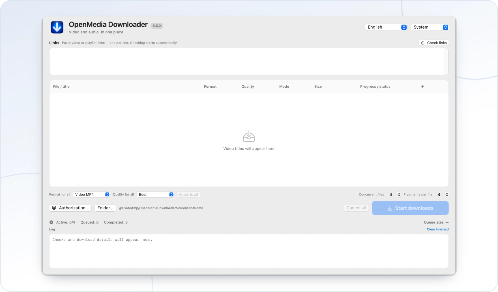

<!-- ppk-readme:head:start -->
<a href="https://popovantondev.github.io/openmedia-downloader/index-en.html"><picture><source media="(prefers-color-scheme: dark)" srcset="https://raw.githubusercontent.com/popovantondev/openmedia-downloader/main/docs/readme/header-en-dark.4a83faed.svg"></picture></a>
<!-- ppk-readme:head:end -->

# OpenMedia Downloader

[Русский](README.ru.md) · [Deutsch](README.md) · **English**

<!-- ppk-readme:body:start -->

<a href="https://github.com/popovantondev/openmedia-downloader"><picture><source media="(prefers-color-scheme: dark)" srcset="https://raw.githubusercontent.com/popovantondev/openmedia-downloader/main/docs/readme/btn-source-en-dark.702ac7b3.svg"></picture></a>
<a href="https://popovantondev.github.io/openmedia-downloader/index-en.html"><picture><source media="(prefers-color-scheme: dark)" srcset="https://raw.githubusercontent.com/popovantondev/openmedia-downloader/main/docs/readme/btn-website-en-dark.2af84c32.svg"></picture></a>
<a href="https://popovantondev.github.io/openmedia-downloader/Guide-en.html"><picture><source media="(prefers-color-scheme: dark)" srcset="https://raw.githubusercontent.com/popovantondev/openmedia-downloader/main/docs/readme/btn-guide-en-dark.9ec0c2df.svg"></picture></a>
<a href="https://github.com/popovantondev/openmedia-downloader/issues/new/choose"><picture><source media="(prefers-color-scheme: dark)" srcset="https://raw.githubusercontent.com/popovantondev/openmedia-downloader/main/docs/readme/btn-bug-en-dark.8965f4a1.svg"></picture></a>

<a href="https://raw.githubusercontent.com/popovantondev/openmedia-downloader/main/assets/screenshots/en/main-window.png"><picture><source media="(prefers-color-scheme: dark)" srcset="https://raw.githubusercontent.com/popovantondev/openmedia-downloader/main/docs/readme/preview-en-dark.f5140c98.webp"></picture></a> 
<a href="https://raw.githubusercontent.com/popovantondev/openmedia-downloader/main/assets/screenshots/en/main-window.png">Full screenshot</a>

<picture><source media="(prefers-color-scheme: dark)" srcset="https://raw.githubusercontent.com/popovantondev/openmedia-downloader/main/docs/readme/divider-dark.5ffb706c.svg"></picture>
<!-- ppk-readme:body:end -->

<!-- public-release:start -->
Inspect supported media links and select authorized downloads or supported stream recordings.

**macOS 15+ · Apple Silicon · Source only 5.5.0**

**[Source](https://github.com/popovantondev/openmedia-downloader)** · **[User guide](https://popovantondev.github.io/openmedia-downloader/Guide-en.html)** · **[Report a problem](https://github.com/popovantondev/openmedia-downloader/issues/new/choose)**

**Requirements and limitations:** Source only: redistribution clearance for bundled third-party components is pending. Save only media you are authorized to keep.

**First steps:** Read the documentation and release status. No ready-to-use app DMG or ZIP is offered.
<!-- public-release:end -->

OpenMedia Downloader is a native app for macOS 15 or later on Apple silicon. It inspects supported YouTube and Vimeo links, lets you choose media and quality, and downloads files or records supported ongoing streams. Public documentation describes the 5.5.0 development line; packaging is not cleared for distribution yet ([status](docs/RIGHTS_EN.md)).

**No DMG is included:** the licensing and source-provenance review for third-party components bundled in the app is not complete, so redistribution clearance for that binary has not been established. This is an open licensing/compliance gate, not a packaging error. The project code has a separate PolyForm Strict license; it permits non-commercial use but does not grant recipients downstream redistribution or derivative-work rights. See [rights and release status](docs/RIGHTS_EN.md).

## Features

- Progressive title and playlist discovery; playlist items begin unselected.
- MP4 video, AAC audio saved as M4A when available, and MP3 audio conversion.
- Quality and automatic, direct, or segmented transfer choices where the source offers them.
- Multiple variants, a queue, per-file progress, cancellation, and concurrent downloads.
- Detection and recording of supported ongoing streams, with a clear stop-and-save action.
- Optional browser authentication. Public media can be tried without cookies.
- Interface in German, English and Russian.

## Start a download

1. On first launch, choose English, German, or Russian. The choice is remembered; change it in the main window at any time. System appearance is the default; light and dark appearance can be selected.
2. Paste a supported video or playlist link. Inspection shows available titles and statuses as they arrive. Inspection does not enqueue a download.
3. For a playlist, select the items you want. Rows start unchecked; unavailable entries may remain in the list with a status.
4. Choose MP4 video, AAC/M4A audio, or MP3 audio, then choose an available quality and transfer mode. Options depend on the source.
5. Choose an output folder, add the jobs, and start. The queue shows each job separately. You can cancel an item or cancel all jobs.

Several formats of one video are separate jobs. The default concurrency is four files and four fragments per file; these settings can be changed. A displayed `≈` marks an estimate. Unknown size is shown as unknown, not zero.

## Formats and streams

MP4 video is remuxed where needed. AAC is copied without re-encoding and saved in an M4A container only when a suitable AAC source exists. MP3 requires audio conversion. See [format, quality and transfer details](docs/FORMATS_AND_STREAMS_EN.md).

Supported live or ongoing streams are identified during inspection. Choose recording from the current point, or choose from the beginning only when the source reports that option as supported. Live progress uses elapsed time, bytes, and rate; it does not invent a percentage or final size. Use **Stop and save** to end a recording cleanly. A recording is complete only after finalization and validation. See the [formats and streams guide](docs/FORMATS_AND_STREAMS_EN.md) for limitations.

## Cookies and troubleshooting

Cookies are optional and sensitive. Public videos can be attempted without them. Safari cookie access requires Full Disk Access granted to **OpenMedia Downloader 5.5**, followed by quitting and reopening that app. Safari itself does not need this permission, and a browser normally does not have to remain open after its cookies have been saved. Details: [cookie guide](docs/COOKIES_EN.md).

If a link cannot be inspected, verify that it is supported and reachable, then inspect again. If a format is missing, the source may not provide it. For cookie errors, retry without cookies for public media or choose another supported authentication method. See [troubleshooting](docs/TROUBLESHOOTING_EN.md).

## Build from source

The [architecture and source-development guide](docs/ARCHITEKTUR_BUILD_EN.md) explains the app structure and Swift checks (`swift build`, `swift test`). This source-only snapshot omits bundled runtimes, media-tool binaries, and third-party source archives, so it is not a complete app build kit. No command publishes or uploads the project.

## More

- [Architecture and build guide](docs/ARCHITEKTUR_BUILD_EN.md)
- [Changelog](CHANGELOG.en.md)
- [Third-party component overview](docs/THIRD_PARTY_OVERVIEW_EN.md)
- [Privacy-safe screenshot guide](docs/SCREENSHOTS_EN.md)

Only download media you have permission to save. The app does not bypass DRM, paywalls, or account access controls.

Bug reports should use the [issue forms](https://github.com/popovantondev/openmedia-downloader/issues/new/choose). Please do not attach browser profiles, cookies, account details, private logs, or unredacted screenshots.

## Rights and license

Project license: [PolyForm Strict 1.0.0](LICENSE), for non-commercial use. Rights and release status: [Rights](docs/RIGHTS_EN.md).
