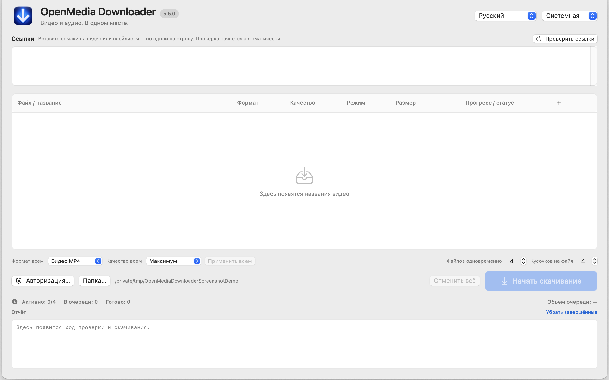

# OpenMedia Downloader

**Языки:** [Deutsch](README.md) · [English](README.en.md) · Русский

<!-- public-release:start -->
Проверяет поддерживаемые медиассылки и позволяет выбрать разрешённую загрузку или запись трансляции.

**macOS 15+ · Apple Silicon · Только исходники 5.5.0**

**[Исходники](https://github.com/popovantondev/openmedia-downloader)** · **[Инструкция](https://popovantondev.github.io/openmedia-downloader/Guide-ru.html)** · **[Сообщить об ошибке](https://github.com/popovantondev/openmedia-downloader/issues/new/choose)**

**Требования и ограничения:** Только исходники: распространение готового приложения пока не согласовано по сторонним компонентам. Сохраняйте только материалы, на которые у вас есть право.

**Первые шаги:** Откройте документацию и статус распространения. Готовый DMG или ZIP приложения сейчас не предлагается.
<!-- public-release:end -->

OpenMedia Downloader — нативное приложение для macOS 15 или новее на Apple silicon. Оно проверяет поддерживаемые ссылки YouTube и Vimeo, помогает выбрать формат и качество, загружает файлы и записывает поддерживаемые текущие трансляции. Документация относится к линии разработки 5.5.0; пакет пока не допущен к распространению ([статус](docs/RIGHTS_RU.md)).

**DMG пока не включён:** проверка лицензий и происхождения сторонних компонентов, встроенных в приложение, не завершена, поэтому право распространять эту бинарную сборку пока не подтверждено. Это незакрытая лицензионная проверка, а не ошибка сборки. На код проекта отдельно распространяется PolyForm Strict: она разрешает некоммерческое использование, но не даёт получателям права распространять программу дальше или создавать производные версии. Подробнее: [права и статус выпуска](docs/RIGHTS_RU.md).

## Возможности

- Названия и записи плейлистов определяются постепенно; записи плейлиста изначально не выбраны.
- Видео MP4, звук AAC в контейнере M4A (если доступно) и преобразование в MP3.
- Выбор качества и режима передачи (автоматически, напрямую или по фрагментам), если источник их предлагает.
- Несколько вариантов, очередь, прогресс по каждому файлу, отмена и параллельные загрузки.
- Обнаружение и запись поддерживаемых текущих трансляций с понятным действием «Остановить и сохранить».
- Необязательный вход через браузер (cookies). Публичные материалы можно пробовать без cookies.
- Интерфейс на немецком, английском и русском языках.

## Как скачать видео

1. При первом запуске выберите русский, немецкий или английский язык. Выбор сохраняется; сменить язык можно в главном окне. По умолчанию используется тема macOS, также доступны светлая и тёмная темы.
2. Вставьте поддерживаемую ссылку на видео или плейлист. Названия и статусы появляются по мере проверки. Проверка сама по себе не добавляет загрузки в очередь.
3. Для плейлиста отметьте нужные записи. Изначально ничего не выбрано.
4. Выберите видео MP4, аудио AAC/M4A или MP3, затем доступное качество и режим передачи. Набор вариантов зависит от источника.
5. Выберите папку, добавьте задания и запустите очередь. Задания можно отменить по одному или все сразу.

Разные форматы одного видео являются отдельными заданиями. По умолчанию одновременно загружаются четыре файла, по четыре фрагмента на файл; настройки можно изменить. Знак `≈` означает приблизительный размер. Неизвестный размер не показывается как ноль.

## Форматы и трансляции

AAC копируется без перекодирования в контейнер M4A, если источник содержит подходящий AAC. MP3 требует преобразования звука. Поддерживаемую текущую трансляцию можно записывать с настоящего момента. Запись с начала доступна лишь когда источник подтверждает такую возможность; режим экспериментальный. Во время записи показываются время, объём и скорость, без выдуманного процента или конечного размера. Нажмите **Остановить и сохранить** для корректного завершения. Подробнее: [форматы и трансляции](docs/FORMATS_AND_STREAMS_RU.md).

## Cookies и устранение неполадок

Cookies необязательны и конфиденциальны. Публичные видео можно попробовать загрузить без них. Для чтения cookies Safari полный доступ к диску требуется самому приложению **OpenMedia Downloader 5.5**, а не Safari. После разрешения полностью завершите приложение через ⌘Q и откройте снова. Обычно браузер не нужно оставлять запущенным, если cookies уже сохранены. Инструкции: [работа с cookies](docs/COOKIES_RU.md).

Если ссылка не проверяется, убедитесь, что формат ссылки поддерживается и сеть доступна, затем повторите проверку. Если варианта формата нет, источник может его не предоставлять. При ошибке cookies попробуйте публичную ссылку без входа. Другие подсказки: [устранение неполадок](docs/TROUBLESHOOTING_RU.md).

## Сборка из исходников

[Руководство по архитектуре и работе с исходниками](docs/ARCHITEKTUR_BUILD_RU.md) описывает устройство приложения и проверки Swift (`swift build`, `swift test`). В этом снимке только исходников намеренно нет встроенных рантаймов, бинарных файлов медиаинструментов и архивов исходников сторонних компонентов, поэтому это не полный набор для сборки приложения. Ни одна команда не публикует и не выгружает проект.

## Документы

- [Лицензия проекта](LICENSE) — PolyForm Strict 1.0.0 для некоммерческого использования.
- [Архитектура и сборка](docs/ARCHITEKTUR_BUILD_RU.md)
- [История изменений](CHANGELOG.ru.md)
- [Права и статус выпуска](docs/RIGHTS_RU.md) · [Обзор сторонних компонентов](docs/THIRD_PARTY_OVERVIEW_RU.md)
- [Инструкция по безопасным скриншотам](docs/SCREENSHOTS_RU.md)

Сохраняйте только те материалы, которые вы имеете право загружать. Приложение не обходит DRM, платный доступ и ограничения учётных записей.

Сообщения об ошибках — через [формы обращений](https://github.com/popovantondev/openmedia-downloader/issues/new/choose). Не прикладывайте профили браузера, cookies, данные учётных записей, личные журналы и неочищенные скриншоты.
